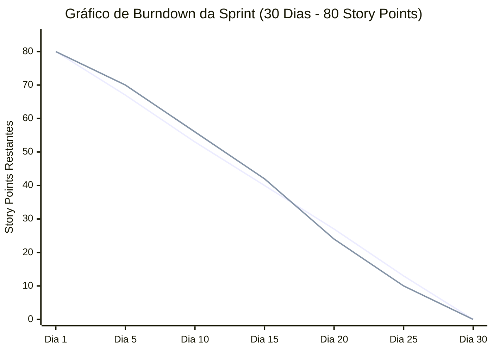
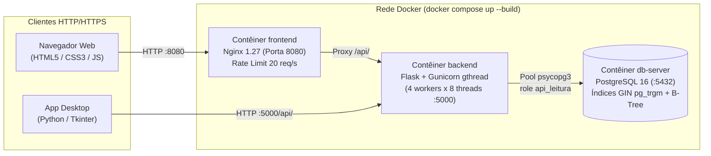

# Relatório Final de Engenharia de Software — Aplicação Full Stack (3º Bimestre)

**Projeto:** Sistema Distribuído de Consulta de Servidores Ativos e Aposentados do Poder Executivo Federal  
**Repositório GitHub:** `https://github.com/mourao013/trabalhospi2`  
**Stack Tecnológica:** Docker & Docker Compose · PostgreSQL 16 (`pg_trgm`) · Python 3.12 + Flask 3 + WSGI Gunicorn (`gthread`) · Nginx + HTML5/CSS3/JS · Desktop Python/Tkinter

---

## 1. Equipe de Desenvolvimento e Divisão de Responsabilidades

Conforme as diretrizes do projeto (equipes de 3 a 4 integrantes com um Líder Técnico), a equipe foi estruturada utilizando metodologia ágil **Scrum**:

| Integrante | Matrícula | Papel na Equipe | Responsabilidades Principais |
| :--- | :---: | :--- | :--- |
| **Carlos Mourão** (`mourao013`) | `171075` | **Líder Técnico & Engenheiro de Backend/DevOps** | Arquitetura Docker Compose, configuração do WSGI Gunicorn multi-thread, segurança da API (anti-SQLi, Rate Limiting, Semáforo de Concorrência), integração geral e coordenação diária da equipe. |
| **Pedro Henrique Cardoso** | `169618` | **Engenheiro de Dados / DBA PostgreSQL** | Estudo do dicionário de dados (`dados.gov.br`), modelagem do PostgreSQL (`01_schema.sql`), normalização em tabelas de domínio (`cargo`, `orgao`, `uf`), índices B-Tree e GIN (`pg_trgm`), usuário read-only (`02_usuario_api.sh`) e pipeline ETL (`importar.py`). |
| **João Vitor** | `171077` | **Engenheiro Front-end Web, Desktop & QA** | Interface Web responsiva em HTML5/CSS3/JS (`frontend/site/`), proxy reverso Nginx (`nginx.conf`), aplicação Desktop em Python/Tkinter (`desktop/app_desktop.py`), suíte de testes unitários (`backend/tests/`) e script de sobrecarga paralela (`teste_sobrecarga.py`). |

---

## 2. Planejamento Ágil (Sprints de 30 Dias) e Histórico de Entregas

O desenvolvimento foi organizado em **2 Sprints de 15 dias (totalizando 30 dias)**, somando **80 Story Points (SP)** distribuídos em 10 épicos técnicos:

### Backlog da Sprint e Delegação de Tarefas

| ID | Tarefa / História de Usuário | Responsável | Matrícula | Pontos (SP) | Status |
| :--- | :--- | :--- | :---: | :---: | :---: |
| **US-01** | Estudo do Dicionário de Dados (`dados.gov.br`) — Aposentados e Carreiras/Cargos | Pedro Henrique Cardoso | `169618` | 6 SP | Concluído |
| **US-02** | Modelagem PostgreSQL + Extensão `pg_trgm` + Índices GIN/B-Tree e Role `api_leitura` | Pedro Henrique Cardoso | `169618` | 10 SP | Concluído |
| **US-03** | Pipeline ETL (`etl/importar.py`) com detecção de encoding/separador e carga `COPY` | Pedro Henrique Cardoso | `169618` | 10 SP | Concluído |
| **US-04** | Orquestração `docker-compose.yml` + `Dockerfile`s (`db`, `backend`, `frontend`) | Carlos Mourão (Líder) | `171075` | 8 SP | Concluído |
| **US-05** | API Flask + WSGI Gunicorn (`gthread`) + Endpoints `/api/servidores`, `/cargos`, `/orgaos`, `/ufs` | Carlos Mourão (Líder) | `171075` | 12 SP | Concluído |
| **US-06** | Validação estrita, proteção contra SQL Injection e tratamento de todas as exceções HTTP | Carlos Mourão (Líder) | `171075` | 8 SP | Concluído |
| **US-07** | Mecanismo anti-sobrecarga (Rate Limit por IP + Semáforo + Pool + Statement Timeout) | Carlos Mourão (Líder) | `171075` | 8 SP | Concluído |
| **US-08** | Aplicação Web (`index.html`, `estilo.css`, `app.js`) com busca exata, similaridade e avançada | João Vitor | `171077` | 10 SP | Concluído |
| **US-09** | Aplicação Desktop (`desktop/app_desktop.py`) consumindo a API HTTP/JSON | João Vitor | `171077` | 4 SP | Concluído |
| **US-10** | Testes unitários (`unittest`) e script de sobrecarga paralela (`teste_sobrecarga.py`) | João Vitor & Carlos Mourão | `171077` / `171075` | 4 SP | Concluído |

---

## 3. Gráfico de Burndown (30 Dias — 80 Story Points)

| Marco da Sprint | Story Points Planejados (Ideal) | Story Points Restantes (Real) | Entregas Principais do Período |
| :--- | :---: | :---: | :--- |
| **Dia 1 (Início)** | 80 SP | 80 SP | Definição da arquitetura Docker (Carlos), leitura do dicionário de dados do `dados.gov.br` (Pedro). |
| **Dia 5** | 67 SP | 70 SP | Criação do contêiner `db-server` (PostgreSQL 16), esquema SQL normalizado e índices `pg_trgm` (Pedro). |
| **Dia 10** | 53 SP | 56 SP | Desenvolvimento do ETL tolerante a falhas de codificação (`cp1252`/`utf-8`) e carga em lote via `COPY` (Pedro). |
| **Dia 15 (Fim Sprint 1)** | 40 SP | 42 SP | Contêiner `backend` com Python + Flask + Gunicorn e endpoints base de consulta e paginação (Carlos). |
| **Dia 20** | 27 SP | 24 SP | Camada de validação (`validacao.py`), bloqueio de SQL Injection (Carlos) e contêiner `frontend` Nginx + UI Web (João Vitor). |
| **Dia 25** | 13 SP | 10 SP | Mecanismos de contenção de sobrecarga (`protecao.py`), App Desktop Tkinter e 33 testes automatizados (João Vitor & Carlos). |
| **Dia 30 (Entrega Final)** | 0 SP | 0 SP | Bateria de testes de sobrecarga paralela, revisão do README/documentação e empacotamento final (Pedro, Carlos & João Vitor). |

---

## 4. Arquitetura do Sistema e Tratamento das Bases de Dados (`dados.gov.br`)

### Síntese do Dicionário de Dados e Otimização do SGBD
1. **Conjuntos contemplados**:
   - *Gestão de Pessoas do Executivo Federal — Aposentados*
   - *Gestão de Pessoas do Executivo Federal — Carreiras/Cargos*
2. **Normalização e Economia de Espaço**:
   - Descrições repetitivas de cargos e órgãos foram extraídas para as tabelas de domínio `cargo` e `orgao`, referenciadas por chave estrangeira inteira (`cargo_id`, `orgao_id`) na tabela `servidor`.
   - Todas as tabelas de texto possuem uma coluna `nome_busca` pré-normalizada (MAIÚSCULA e sem acentos) gravada durante o ETL.
3. **Indexação para Busca Exata e por Similaridade**:
   - `idx_servidor_nome_exato`: Índice B-Tree com `text_pattern_ops` para busca exata instantânea (`WHERE nome_busca = %s`).
   - `idx_servidor_nome_trgm`: Índice GIN com `gin_trgm_ops` (extensão `pg_trgm`) para busca por curingas (`LIKE '%NOME%SOBRENOME%'`) e cálculo de score `similarity(nome_busca, %s)`.
   - Índices compostos `(cargo_id, uf)` e `(orgao_id, uf)` para buscas combinadas avançadas.

---

## 5. Mecanismos de Segurança, Tratamento de Erros e Testes de Sobrecarga

### Situações Tratadas pela API (`/api/servidores`)

| Situação Exigida no Edital | Tratamento Implementado na API | Código HTTP |
| :--- | :--- | :---: |
| **Strings inválidas** | Regex estrita por campo (`RE_NOME`, `RE_SIMILAR`, `RE_TEXTO`) e limites de tamanho (2 a 100 caracteres). | `400 Bad Request` |
| **Tentativas de SQL Injection** | Detecção ativa via `RE_SQL_INJECTION` (`UNION`, `SELECT`, `DROP`, `--`, `OR 1=1`, `pg_sleep`) + queries 100% parametrizadas + role `api_leitura` somente leitura. | `400 Bad Request` |
| **Nome não encontrado** | Verifica total de registros e retorna JSON estruturado com código `NAO_ENCONTRADO`. | `404 Not Found` |
| **Nome retornando múltiplos registros** | Retorna flag `"multiplos": true`, lista paginada em `resultados` e mensagem informativa. | `200 OK` |
| **Cargos inválidos / inexistentes** | Caracteres inválidos retornam `400`; cargo inexistente na tabela de domínio retorna `404` (`CARGO_INVALIDO`). | `400` / `404` |
| **UF inválidas** | Validação contra o conjunto oficial das 27 siglas da federação (`UF_INVALIDA`). | `400 Bad Request` |
| **Instituição/Órgão inválidos** | Caracteres inválidos retornam `400`; órgão não encontrado retorna `404` (`ORGAO_INVALIDO`). | `400` / `404` |
| **Página inexistente** | Quando `pagina > total_paginas`, retorna erro `PAGINA_INEXISTENTE` informando o total disponível. | `404 Not Found` |
| **Tempo de busca excedendo o timeout** | `set_config('statement_timeout', '5000', true)` no PostgreSQL; captura `QueryCanceled` e retorna JSON amigável (`TEMPO_EXCEDIDO`). | `504 Gateway Timeout` |
| **Excesso de buscas ao mesmo tempo** | Semáforo por worker (`BoundedSemaphore`) + Rate Limit por IP (`LimitadorTaxa`) + Nginx `limit_req`, retornando `Retry-After`. | `429` / `503` |
| **Parâmetros de busca inválidos** | Rejeita parâmetros desconhecidos na query string, parâmetros repetidos, vazios ou combinação simultânea de `nome` e `similar`. | `400 Bad Request` |

---

## 6. Análise da Equipe: Pontos Fortes, Pontos Fracos, Dificuldades e Limitações

### Pontos Fortes da Equipe
- **Domínio da Arquitetura em Contêineres**: Separação limpa entre `db-server`, `backend` e `frontend`, com inicialização 100% automatizada via `docker compose up --build`.
- **Foco em Segurança e Resiliência**: Implementação de defesa em profundidade (Nginx + Flask + Pool + PostgreSQL read-only com timeout).
- **Qualidade de Código e Testes**: 33 testes automatizados cobrindo validação, anti-SQLi, ETL e respostas HTTP sem depender de ambiente externo.

### Pontos Fracos e Oportunidades de Melhoria
- **Subestimativa inicial da sujeira dos dados públicos**: Na Sprint 1, a equipe subestimou o tempo necessário para tratar variações de cabeçalho e codificação nos CSVs do Portal da Transparência.
- **Rate Limit em memória local por processo**: O `LimitadorTaxa` em Python mantém contadores na memória de cada worker; em um cluster multi-nó futuro, seria recomendável migrar esse estado para Redis.

### Principais Dificuldades e Impedimentos Encontrados
1. **Diferenças de ambiente Windows vs. Linux nos contêineres**: Scripts shell convertidos para `CRLF` pelo Git no Windows impediam a subida do entrypoint no Linux Alpine/Debian (resolvido com `sed -i 's/\r$//'` nos Dockerfiles).
2. **Performance em buscas com curinga inicial (`%NOME%`)**: Superada com a adoção da extensão `pg_trgm` e índices GIN.
3. **Parametrização do `statement_timeout` no Psycopg 3**: O comando `SET LOCAL` falhava com parâmetros preparados `$1`, exigindo o uso da função `set_config('statement_timeout', %s, true)`.

### Limitações Conhecidas do Sistema (Relatório de Avaliação — Item 7)
1. **Teto de paginação em buscas excessivamente genéricas (`MAX_RESULTADOS = 10.000`)**: Para evitar que um `COUNT(*)` completo em milhões de linhas degrade a latência sob sobrecarga paralela, buscas muito abertas (ex.: filtrar apenas `situacao=ATIVO`) contabilizam e paginam até os primeiros 10.000 registros (`total_exato: false`), orientando o usuário a refinar os filtros.
2. **Limite de 100 registros na busca por similaridade (`SIMILAR_LIMIT_MAX = 100`)**: Conforme especificado no enunciado (`limit=100`), o cálculo de distância de trigramas (`similarity()`) é limitado aos 100 nomes mais semelhantes para preservar a CPU do banco.
3. **Tempo de primeira inicialização com CSVs massivos**: Na primeira execução com gigabytes de CSVs reais em `db/dados/`, o ETL leva alguns minutos para popular e indexar a base via `COPY` (nas execuções seguintes, a tabela `controle_importacao` detecta que os arquivos já foram carregados e sobe instantaneamente).
